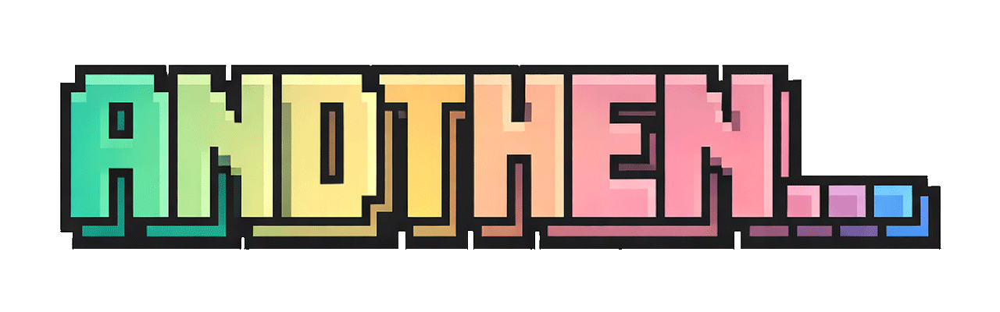
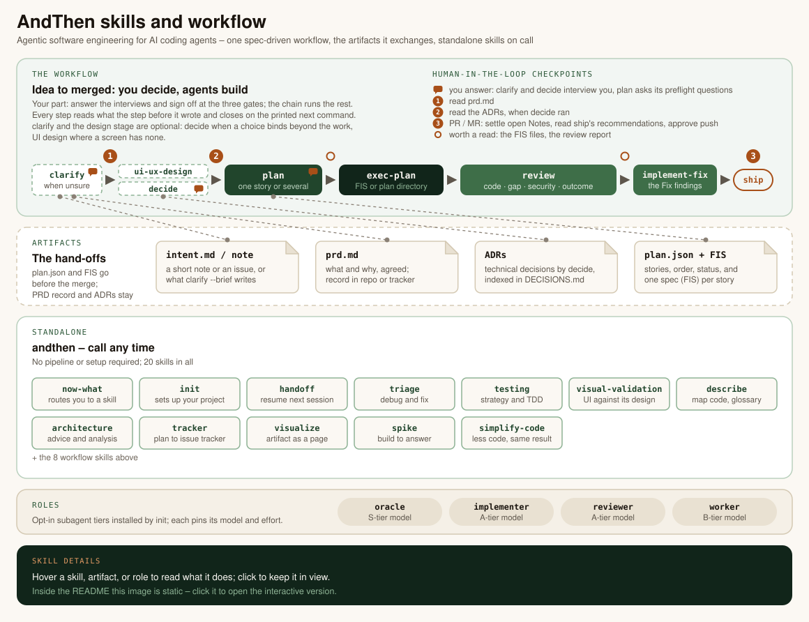

<p align="center">
  
</p>

<p align="center">
  <i>Lightweight and flexible agentic software engineering for AI coding agents, spec-driven when the work needs a spec.</i>
</p>

> "I have a feature idea" → *and then?* → **clarify** → *and then?* → **plan** → *and then?* → **exec-plan** → *and then?* → **review** → **ship it.**

AndThen is a set of skills for AI coding agents (Claude Code, Codex CLI, GitHub Copilot CLI, and others) that covers the whole agentic software engineering process: requirements, architecture, design, implementation, testing, review, and debugging. Its main workflow is spec-driven: for anything bigger than a small fix, the agent writes a spec first and then builds against it. The spec says what to build, how to prove it works, and when it is done.

What AndThen enforces, so you don't have to:

- **Nothing is done on the agent's word.** A story is marked done only with a quoted line from the check that proved it, written by the session that ran the check.
- **The code is reviewed by an agent that didn't write it.** Every story gets a review from a fresh subagent that checks it against its spec.
- **Specs don't go stale.** The plan and its specs belong to one branch and are deleted before the merge unless you keep them as a record. The requirements document (`prd.md`) is what stays, or its issue when you keep requirements in the tracker.
- **Process is sized to the work.** A change you can state in one sentence skips the specs entirely (`implement-fix`).

It is one plugin, `andthen`, with 21 skills and no runtime of its own to install. There is no CLI to install and no tool directory to commit: skills find your specs and docs through an index in `CLAUDE.md` / `AGENTS.md`.

<p align="center">
  <a href="https://github.com/IT-HUSET/andthen/raw/main/assets/skills-overview.svg"></a>
  <br><sub>Click the figure for the interactive version: hover a skill, artifact, or role to see what it does.</sub>
</p>


## Quick start

```bash
# Claude Code
/plugin marketplace add IT-HUSET/andthen
/plugin install andthen@andthen
/andthen:init                      # set up your project
/andthen:now-what                  # ...and let it route you from there

# Codex CLI
codex plugin marketplace add IT-HUSET/andthen
codex plugin add andthen@andthen

# GitHub Copilot CLI
copilot plugin marketplace add IT-HUSET/andthen
copilot plugin install andthen@andthen
```

On Codex, ask for a skill by name: *Run the `andthen:init` skill*. This works on every host. The `/andthen:<name>` commands on this page are Claude Code's and Copilot CLI's.

> [!NOTE]
> **1.0 is a breaking release.** Have 0.x installed? [Update the plugin](#upgrading-from-0x): 1.0 comes from the same marketplace. Retired 0.x skills and flags have no aliases, and 0.x specs must be rewritten with `plan` before they run: [MIGRATING-FROM-0.x.md](MIGRATING-FROM-0.x.md) walks you through it. AndThen is experimental, and skills still change shape between minor versions.


## The workflow

Five terms you will see throughout:

- **PRD** (`prd.md`) – the requirements document `clarify` writes: the problem, who has it, and what counts as solved.
- **Story** – one slice of the work, small enough for one agent session to build and prove.
- **FIS** (Feature Implementation Specification) – the spec for one story: what to build, the tests that prove it, and the tasks. `plan` writes one per story.
- **Plan** (`plan.json`) – the list of stories, their order, and each one's status, kept beside the FIS files.
- **Fresh session** – a new conversation (`/clear` in Claude Code). Each step reads the files the previous step wrote, so it starts on a clean context.

The path through the workflow:

```
[clarify] → [decide] → [ui-ux-design] → plan → exec-plan → review --fix → ship
```

1. **`clarify`** (optional) interviews you and writes the PRD. Skip it when the requirements already exist, in your head, an issue, or a document. A rule of thumb: if you can't list three concrete acceptance criteria, you have an idea, not requirements.
2. **`decide`** (optional) settles a technical choice that reaches beyond this work or is costly to reverse, and records it as an architecture decision record (ADR). **`ui-ux-design`** (optional) designs new screens first when you choose that.
3. **`plan`** writes the specs. It decides whether the work is one story or several.
4. **`exec-plan`** builds the stories, one per fresh session. For each one it writes the code and tests, runs every check, has a fresh subagent review it, commits, and then simplifies the result. What a story learns goes into the stories still to run.
5. **`review --fix`** reviews the finished work as a whole and applies the findings it marks `Fix`. Findings marked `Note` are left for you to decide. A clean review ends on a `Next (fresh session):` line for `ship`.
6. **`ship`** lands what each story's `Implementation Observations` hold worth keeping, commits, and shows the PR title and body (a merge request on GitLab). It pushes and opens it after your one yes, and that question also asks whether to delete `plan.json` and the FIS files. The PR body states the change's intent, outcomes, and proof, in your PR template when you have one. With `prd.md`, it is where the stories' intent outlives deleted FIS files, however you merge.

Every step ends by printing the full next command to paste, including its target and required arguments. Not sure where you are? `/andthen:now-what` reads your project state and sends you to the right skill.

### From a one-line request

`plan` treats a request typed inline as one story:

```bash
/andthen:plan "users can export their data"                    # writes the FIS and its one-story plan.json
/andthen:exec-plan docs/specs/data-export/s01-data-export.md   # fresh session: builds and reviews the story
/andthen:review --fix docs/specs/data-export/plan.json   # fresh session: the Next line exec-plan printed
/andthen:ship docs/specs/data-export/plan.json           # fresh session: the Next line review printed
```

### From a PRD

`plan` splits a written source (a PRD, a requirements file, an issue) into as many stories as it needs, often just one. `exec-plan` then takes one story per session, and each run prints the next:

```bash
/andthen:clarify "users should be able to export their data"   # interviews you, writes docs/specs/data-export/prd.md
/andthen:plan docs/specs/data-export/                          # fresh session: plan.json and one FIS per story
/andthen:exec-plan docs/specs/data-export/s01-export-request.md   # fresh session: the Next line plan printed
/andthen:exec-plan docs/specs/data-export/s02-export-download.md  # fresh session: the Next line S01 printed
/andthen:review --fix docs/specs/data-export/plan.json   # fresh session: the Next line the last story printed
/andthen:ship docs/specs/data-export/plan.json           # fresh session: the Next line review printed
```

To build every story without stopping, from CI or in parallel worktrees, run `exec-plan` on the plan directory instead (`--auto`, `--worktree`). It gives each story a fresh subagent and runs the full checks once at the end instead of after every story.

Each review mode (lens) checks one thing: `code` the code itself, `gap` whether it matches its source and specs, `security` its vulnerabilities, and `outcome` whether the feature solves the problem the PRD describes. `review` picks the lenses the plan supports, so paste the line `exec-plan` printed.

### Where you take part

You answer when `clarify` and `decide` interview you and when `plan` asks its preflight questions. Between stories you read the report of the one that just ran and any FIS it changed for the stories ahead, and adjust the next story before it runs ([revising a spec](COOKBOOK.md#revising-a-spec-or-re-planning)). Three points need your sign-off, because what they hold outlives the branch:

- **After `clarify`** – read `prd.md`. Every story is cut from it, and it is the one planning file that survives the merge, unless your requirements live in the tracker.
- **After `decide`**, when it ran – read the ADRs. Every later skill treats them as settled.
- **At the PR** – review it as you would any PR. `ship` lands the observations worth keeping and prints its recommendations for the rest, so read those and settle the review's open `Note` findings, which are decisions left to you, before you say yes to its push-and-PR question.

Two more reads pay off when you have the time: the FIS files after `plan`, with what you decided and what the run assumed listed above the next command, and the review report.

### Smaller work

Two skills change code without a spec:

```bash
/andthen:implement-fix "return 404 instead of 500 for an unknown export job id"   # a change you can state in one sentence
/andthen:triage "tests fail on main since yesterday"                             # something is broken and you don't know why
```

The [Cookbook](COOKBOOK.md) has a recipe for each situation, starting with [choosing a path](COOKBOOK.md#choosing-a-path), and follows [one feature end to end](COOKBOOK.md#the-worked-example-workspace-invitations).


## Core skills

The nine skills most work starts from:

| Skill | What it does |
|---|---|
| `init` | Sets up a project: the document index in `CLAUDE.md` / `AGENTS.md`, the project's test commands, and offers for the optional extras |
| `now-what` | Reads your project state and routes you to the right skill |
| `clarify` | Interviews you about an idea and writes the PRD; `--brief` stops at a shorter `intent.md` you can share first; ask for all its questions at once to get one list for a colleague or an issue reply |
| `domain` | Models the domain with you as the expert: subdomains and bounded contexts in a Domain Map, the glossary of shared terms, and event storming |
| `decide` | Settles technical choices with you and records them as ADRs |
| `plan` | Decides whether the work is one story or several, and writes one FIS per story plus the `plan.json` that tracks them |
| `exec-plan` | Builds one FIS, or every story in a plan, each proven by its checks and reviewed by a fresh subagent |
| `review` | Reviews code, spec conformance, security, or the outcome against the PRD; also reviews PRs |
| `handoff` | Writes a document a fresh session can resume from when a session has to end mid-work |

The other twelve are `implement-fix`, `ship`, `triage`, `testing`, `architecture`, `describe`, `ui-ux-design`, `visual-validation`, `visualize`, `tracker`, `spike`, and `simplify-code`. The [skill reference](plugin/README.md#skills) covers all 21 skills, with every flag and mode.


## Installation

The [quick start](#quick-start) installs the latest release from `main` on all three plugin hosts. To pin a release, add its tag: `IT-HUSET/andthen@v1.0.0` on Claude Code and Codex, and `https://github.com/IT-HUSET/andthen.git#v1.0.0` on Copilot CLI, which takes a URL fragment instead of `@`.

Pre-releases of the next version live on the `develop` branch. `IT-HUSET/andthen@develop` follows them (Copilot: `#develop`), and a tag such as `@v1.1.0-rc.1` pins one. If you installed a 1.0 release candidate from `@develop`, you are now on 1.0.0 and will get the next pre-releases: to get only releases, remove the marketplace and add it again as `IT-HUSET/andthen`.

### Upgrading from 0.x

1.0 ships from the same marketplace as 0.x: `andthen`, added from `IT-HUSET/andthen`. Refresh the marketplace and update the plugin:

```bash
# Claude Code (auto-update, when on, does this at startup)
/plugin marketplace update andthen
/plugin update andthen@andthen                 # restart to apply

# Codex CLI
codex plugin marketplace upgrade andthen
codex plugin add andthen@andthen

# GitHub Copilot CLI
copilot plugin marketplace update andthen
copilot plugin update andthen@andthen
```

A marketplace added with a tag, such as `IT-HUSET/andthen@v0.40.4`, stays on that tag: remove it and add it again as in the [quick start](#quick-start). Hosts upgrade with their own commands, and `scripts/andthen.py` is for a [checkout or a container](#from-a-checkout-or-in-a-container).

Updating replaces the skills, not your 0.x specs, which need rewriting before they run: [MIGRATING-FROM-0.x.md](MIGRATING-FROM-0.x.md) covers that and the retired skill names.

### Staying on 0.x

0.40.4 is the last 0.x release, tagged `v0.40.4`. It gets no further changes, and its own [README](https://github.com/IT-HUSET/andthen/blob/v0.40.4/README.md) documents it. To install it, or to go back to it from 1.0, remove the marketplace and add it again with the tag pinned:

- **Claude Code and Codex:** `IT-HUSET/andthen@v0.40.4` in place of `IT-HUSET/andthen`.
- **Copilot CLI:** `https://github.com/IT-HUSET/andthen.git#v0.40.4` in place of `IT-HUSET/andthen`.
- **Loose skills:** check out the tag (`git checkout v0.40.4`) and run the installer that tag's own README names.

### Host options

- **Claude Code** – `/plugin install andthen@andthen --scope project` installs for the current project only; the default is your user. Turn on auto-update in `/plugin` → **Marketplaces** → `andthen` → **Enable auto-update**.
- **Codex CLI** – if you copied the skills into `~/.agents/skills` before (a loose install), delete the old `andthen-*` directories first, or Codex lists every skill twice.
- **GitHub Copilot CLI** – a project or personal skill with the same name as an AndThen skill (`review`, `plan`) silently replaces it; rename yours or list it in `disabledSkills`. Role agents and the conversation style come from `init`, as on the other hosts. Copilot support is load-checked in CI, not covered by the evals.

### From a checkout, or in a container

`scripts/andthen.py install` installs the plugin on every host whose CLI is on `PATH`, from the tree it sits in, reads the installed version back, and exits non-zero on any mismatch. `--dry-run` prints the plan and writes nothing.

```bash
python3 scripts/andthen.py install                  # plugin from this checkout
python3 scripts/andthen.py install --roles --rules  # plus user-level role agents and critical rules

# With no checkout, such as an image build, it downloads the latest release first
curl -fsSL https://raw.githubusercontent.com/IT-HUSET/andthen/main/scripts/andthen.py | python3 - install --roles --rules
```

`--ref v<version>` pins a release, a checkout included. The download lands in `${XDG_DATA_HOME:-~/.local/share}/andthen/<version>` and stays, because Copilot loads it live. A role file or rules block that differs from AndThen's is refused (`--replace-roles` overwrites a role file), and `--trust <path>` marks a project trusted in Codex.

In a container, install when the image is built, not on every start, and pass `--trust` with the project's path so Codex applies its config. A volume mounted over the home folder (`~/.claude`, `~/.codex`, `~/.copilot`, `~/.local/share`) hides what the build placed there; then run the install at start instead, where a second run changes nothing. Placement does not prove the sandbox's plan offers the models the role agents pin, so run one short prompt per host.

### Other agents (Aider, Cursor, Gemini CLI, opencode)

`--loose` copies the skills into your agent's skills directory under `andthen-` names, each bundle self-contained. Invoke them with `$andthen-<skill>` in Codex and other agents that read `~/.agents/skills`.

```bash
python3 scripts/andthen.py install --loose                                  # all skills into ~/.agents/skills
python3 scripts/andthen.py install --loose --dry-run                        # preview what it will do
python3 scripts/andthen.py install --loose --skills clarify,plan,review     # a subset
python3 scripts/andthen.py install --loose --skills-dir <path>              # custom skills directory
```

Without `--skills-dir` it refuses while the AndThen Codex plugin is installed, because Codex reads `~/.agents/skills` too. A reinstall replaces the skills it installed before but leaves retired ones in place.


## Project setup

```bash
/andthen:init
```

`init` works on new projects, half-set-up ones, and existing codebases. In an existing repository it asks nothing; in an empty one it asks what the project is. It writes:

- the **Project Document Index** in `CLAUDE.md` / `AGENTS.md`, which tells every skill where your specs and docs live (with both hosts, `AGENTS.md` holds it and `CLAUDE.md` imports it);
- when the project has a manifest (`package.json`, `pyproject.toml`, and the like), a **Key Dev Commands** document with its fast and full test commands;
- two `.gitignore` entries.

Every other document is created by the first skill that needs it. The closing summary offers the optional extras one line each: role agents that pin a model per kind of work, critical rules for your instruction file, a map of an existing codebase (`describe`), and a testing strategy. The [skill reference](plugin/README.md#foundational-rules-and-conversation-style) covers the rules and the optional `concise-critical` conversation style.

To set up by hand instead, start from [`CLAUDE.template.md`](plugin/skills/init/templates/CLAUDE.template.md).


## Permissions, sandboxing, and hooks

`exec-plan` runs for a long time without you watching, so it is worth limiting what the agent's shell commands can reach. They run as you. Approval prompts and allow/deny rules decide what asks you first, but a command you approve can still read `~/.ssh` or send data anywhere. An OS sandbox closes that gap. Every command and its child processes can write only inside the workspace, has no network, and cannot read the files you deny. Codex turns its sandbox on by default; Claude Code does not.

- [`permissions/`](permissions/README.md) – example settings for both hosts. The sandbox is on and the network off. Commands cannot see `.env` files, cloud credentials, browser profiles, or token variables. `git push` asks first, the destructive-command hook below runs before every command, and Claude Code's bypass flag is refused. Organization-enforced variants are included.
- [`hooks/`](hooks/README.md) – four optional hooks: a guard against destructive shell commands, desktop or voice notifications, and a context-size hint that tells you when to start a fresh session. The guard matches patterns, so it adds a layer and does not replace the sandbox.

Run `--dangerously-skip-permissions` or `--yolo` only inside a container or VM that holds none of your credentials.


## More

- [`COOKBOOK.md`](COOKBOOK.md) – what to type for each situation, how the workflow fits together, [working in a team](COOKBOOK.md#working-in-a-team), [coming from Spec Kit, Kiro, BMAD, or GSD](COOKBOOK.md#coming-from-spec-kit-kiro-bmad-or-gsd), and a worked example.
- [`plugin/README.md`](plugin/README.md) – the skill reference: every flag, mode, and edge case.
- [`MIGRATING-FROM-0.x.md`](MIGRATING-FROM-0.x.md) – upgrading a 0.x project: what changed, the steps, and a prompt that does them.
- [`docs/PRODUCT.md`](docs/PRODUCT.md) – goals, non-goals, and how AndThen weighs verification against ceremony.
- [`docs/ARCHITECTURE.md`](docs/ARCHITECTURE.md) – how the plugin is built, for contributors.
- [`docs/MODEL-EFFORT-SELECTION-GUIDE.md`](docs/MODEL-EFFORT-SELECTION-GUIDE.md) – choosing models and thinking effort.
- Works well with: [Agent Browser](https://github.com/vercel-labs/agent-browser), and from the [official marketplace](https://github.com/anthropics/claude-plugins-official) `playground` and `claude-md-management`, and [`semgrep`](https://github.com/semgrep/mcp-marketplace) (external, recommended there).


## Other useful skill libraries

AndThen has much in common with other skill libraries for agentic engineering and spec-driven development (SDD), especially those that cover the whole development lifecycle without being rigidly prescriptive or using proprietary conventions. And although AndThen covers the main development workflow on its own, it works well with complementary skill libraries, for instance:

- [Matt Pocock's Skills For Real Engineers](https://github.com/mattpocock/skills/)
- [pstack by @poteto](https://github.com/cursor/plugins/tree/main/pstack)
- Anthropic's [official plugin marketplace](https://github.com/anthropics/claude-plugins-official), for instance `frontend-design` (visual direction when building UI), `skill-creator` (write and eval your own skills), and `claude-md-management` (audit CLAUDE.md files and capture session learnings in them).


## Inspired by _(name)_

[](https://www.youtube.com/watch?v=oqwzuiSy9y0)

and then

[](https://www.youtube.com/watch?v=fPzvUW8qaWY)


## Actually inspired by

Too many to list, but special shoutout to:
- [Peter Steinberger](https://github.com/steipete)
- [Cole Medin](https://github.com/coleam00)
- [IndieDevDan](https://github.com/disler)
- [Matt Pocock](https://github.com/mattpocock)
- [Addy Osmani](https://github.com/addyosmani)
- [Mario Zechner](https://github.com/badlogic)
- [Matt Maher](https://github.com/bladnman)

## License

[MIT](LICENSE).
